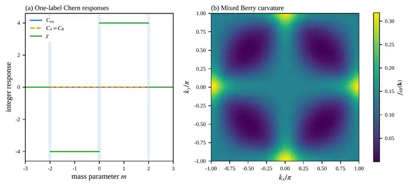

# Entangling Topological Invariants

**Mixed topological responses, cross pumping, and tensor factorization in quantum systems.**

[Read the paper](https://arxiv.org/abs/2608.03634) · [Quick start](#quick-start) · [Code](entangling-topological-invariants/code/) · [Data](entangling-topological-invariants/data/) · [Figures](entangling-topological-invariants/figures/)

[](entangling-topological-invariants/figures/fig1_zero_marginal.pdf)

**Topology revealed by the mixed response.** The total and one-label Chern responses vanish, while the mixed invariant reaches χ = ±4. The right panel shows the mixed Berry curvature at m = 1, whose integral gives χ = 4. Click the image to open the vector figure.

## Overview

This repository accompanies *Entangling Topological Invariants* by **Kazuki Ikeda and Yaron Oz**. It provides the numerical models, data, and figures for three connected aspects of topology in composite quantum systems:

- **Mixed Chern topology.** A joint response detects topology that is invisible to the total and one-label responses. The calculations track this invariant and the spectral gaps needed to resolve the specified sectors.
- **Cross pumping.** Ribbon spectra and finite-cylinder time evolution connect the mixed invariant to transport resolved by the second label, including its behavior under disorder.
- **Tensor factorization.** Models on the four-sphere examine topological obstructions to a global 2 × 2 factorization of a rank-four occupied bundle, using second-Chern calculations and projector tomography.

## Explore the results

| Figure | What it shows |
| --- | --- |
| [Figure 1 — Mixed topology](entangling-topological-invariants/figures/fig1_zero_marginal.pdf) | Nonzero mixed Chern response with vanishing total and one-label responses. |
| [Figure 2 — Label mixing](entangling-topological-invariants/figures/fig2_label_mixing.pdf) | Spectral gaps, resolved sectors, and the curvature contributions to the mixed invariant. |
| [Figure 3 — Cross pumping](entangling-topological-invariants/figures/fig3_edge_realspace_pump.pdf) | Edge spectra and transport in real space during a flux cycle. |
| [Figure 4 — Factorization and tomography](entangling-topological-invariants/figures/fig4_full_reduction_tomography.pdf) | Second-Chern topology and reconstruction of the winding that diagnoses tensor factorization. |

The [figures directory](entangling-topological-invariants/figures/) also contains the supplementary plots. Numerical arrays and tables are available in [data/](entangling-topological-invariants/data/).

## Quick start

Use Bash and Python 3.13, as specified in the supplied [environment file](entangling-topological-invariants/environment.yml). Start by cloning the repository and entering the calculation directory:

```bash
git clone https://github.com/IKEDAKAZUKI/Entangling-Topological-Invariants.git
cd Entangling-Topological-Invariants/entangling-topological-invariants

python3.13 -m venv .venv
source .venv/bin/activate
python -m pip install -r requirements.txt
```

Check the included data schemas, reference values, and figure files:

```bash
python code/check_outputs.py
```

Rebuild the figures, reusing the supplied data for the heavier calculations:

```bash
chmod +x reproduce_all.sh code/run_calculations.sh code/clean_generated.sh
./reproduce_all.sh
```

To regenerate every numerical dataset before rebuilding the figures:

```bash
REGENERATE_ALL=1 ./reproduce_all.sh
```

Full regeneration includes parameter scans, finite-time Schrödinger evolution, disorder ensembles, second-Chern integration, and finite-shot tomography. The default command recomputes the lighter calculations and rebuilds all seven PDF figures.

## Code and data guide

All calculation files are under [entangling-topological-invariants/](entangling-topological-invariants/). The command-line drivers in [code/](entangling-topological-invariants/code/) call the following numerical modules:

| Module | Contents |
| --- | --- |
| [mixed_chern.py](entangling-topological-invariants/code/eti/mixed_chern.py) | Qi–Wu–Zhang blocks, mixed Chern curvature, and Figures 1–2. |
| [label_resolution.py](entangling-topological-invariants/code/eti/label_resolution.py) | Projected-label maps and hierarchical sector resolution. |
| [pump.py](entangling-topological-invariants/code/eti/pump.py), [pump_figures.py](entangling-topological-invariants/code/eti/pump_figures.py) | Ribbon Hamiltonians, finite-cylinder evolution, and Figure 3. |
| [s4_geometry.py](entangling-topological-invariants/code/eti/s4_geometry.py), [s4_pipeline.py](entangling-topological-invariants/code/eti/s4_pipeline.py) | Yang projectors, second-Chern quadrature, Pauli-string models, and transition functions. |
| [tomography.py](entangling-topological-invariants/code/eti/tomography.py) | Finite-shot tomography and readout errors. |
| [robustness.py](entangling-topological-invariants/code/eti/robustness.py) | Disorder ensembles, coupling diagnostics, and figure assembly. |

Deformation paths and exact endpoint parameters are defined in [parameters.py](entangling-topological-invariants/code/eti/parameters.py). Deterministic seeds are recorded in [config/seeds.json](entangling-topological-invariants/config/seeds.json). The drivers set BLAS thread counts explicitly, and grid sizes, quadrature orders, cylinder dimensions, and shot budgets are specified in the corresponding modules. Dependency versions are pinned in [requirements.txt](entangling-topological-invariants/requirements.txt).

## Citation

Please cite the associated paper when using these calculations, data, or figures:

**Kazuki Ikeda and Yaron Oz, *Entangling Topological Invariants*, [arXiv:2608.03634](https://arxiv.org/abs/2608.03634) (2026).**

```bibtex
@ARTICLE{2026arXiv260803634I,
       author = {{Ikeda}, Kazuki and {Oz}, Yaron},
        title = "{Entangling Topological Invariants}",
      journal = {arXiv e-prints},
     keywords = {Quantum Physics, Mesoscale and Nanoscale Physics, High Energy Physics - Theory, Mathematical Physics},
         year = 2026,
        month = aug,
          eid = {arXiv:2608.03634},
        pages = {arXiv:2608.03634},
          doi = {10.48550/arXiv.2608.03634},
archivePrefix = {arXiv},
       eprint = {2608.03634},
 primaryClass = {quant-ph},
       adsurl = {https://ui.adsabs.harvard.edu/abs/2026arXiv260803634I},
      adsnote = {Provided by the SAO/NASA Astrophysics Data System}
}
```

Software citation metadata are available in [CITATION.cff](entangling-topological-invariants/CITATION.cff).

## License

See [LICENSE](entangling-topological-invariants/LICENSE) for the terms governing the code, data, and figures.
